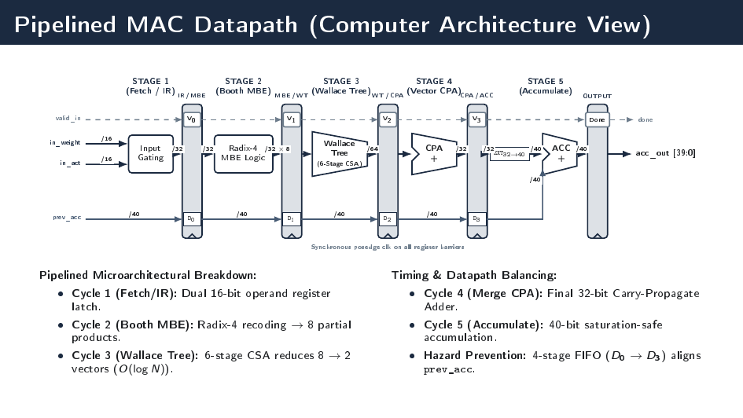

# 16-Bit High-Throughput Pipelined Multiply-Accumulate (MAC) Unit

A high-performance, 5-stage pipelined 16-bit signed fixed-point Multiply-Accumulate (MAC) unit designed in **SystemVerilog**, synthesized with **Yosys**, and timing-verified with **OpenSTA** on the **Nangate 45nm Open-Cell Library**.



---

## Key Highlights & Architectural Features

* **Radix-4 Modified Booth Encoding (MBE):** Encodes 16-bit multiplier operands into 9 partial products, cutting multiplier logic tree height and wire congestion by 50%.
* **Wallace Tree Carry-Save Reduction:** Implements a multi-level carry-save reduction tree using full and half adders, compressing 9 partial-product rows down to carry-save form in $O(\log N)$ delay.
* **Balanced 5-Stage Pipeline:** Eliminates long combinational paths between fetch, Booth recoding, compression, vector addition, and accumulation.
* **Zero-Bubble Continuous Accumulation:** Employs a 4-stage internal FIFO ($D_0 \to D_3$) aligning `prev_acc` operands with newly arriving products, enabling seamless single-cycle throughput without hazard stalls.
* **40-Bit Overflow-Resistant Accumulator:** Features an 8-bit guard headroom covering up to 256 consecutive maximum-magnitude signed 16-bit MAC operations without overflow or precision loss.
* **ASIC Implementation & Timing Closure:** Mapped to **Nangate 45nm**, operating at **555.5 MHz** ($T_{clk} = 1.80\text{ ns}$) with zero hold violations ($WHS = +0.026\text{ ns}$).

---

## 5-Stage Datapath Architecture

| Pipeline Stage | Function | Description |
| :--- | :--- | :--- |
| **Stage 1 (Fetch / IR)** | Input Gating & Latch | Latches 16-bit activation and 16-bit weight operands into input registers. |
| **Stage 2 (Booth MBE)** | Radix-4 Recoding | Generates 9 partial products ($\{-2, -1, 0, +1, +2\} \times A$) using sign-extended Booth encoders. |
| **Stage 3 (Wallace Tree)** | Partial Product Reduction | Carry-Save Adder (CSA) Wallace tree compresses 9 partial products down to 2 vectors (Sum & Carry). |
| **Stage 4 (Merge CPA)** | Vector Merge Addition | 32-bit Carry-Propagate Adder (CPA) merges redundant carry-save vectors into a unified product. |
| **Stage 5 (Accumulate)** | 40-Bit Accumulator | Sign-extends 32-bit product to 40 bits and adds to the FIFO-aligned previous accumulator value. |

---

## ASIC Synthesis & Physical Implementation (Yosys)

Synthesized using **Yosys Open SYnthesis Suite** targeting the **Nangate 45nm Open-Cell Library** (`Nangate45_typ.lib`):

| Metric | Value |
| :--- | :--- |
| **Target Technology** | Nangate 45nm CMOS Standard Cells |
| **Total Standard Cells** | **2,108 cells** |
| **Sequential Elements (DFFs)** | **469 registers** |
| **Total Core Area** | **3,932.81 $\mu\text{m}^2$** |
| **Sequential Area Share** | 2,120.82 $\mu\text{m}^2$ (53.93%) |

---

## Static Timing Analysis (OpenSTA)

Timing analysis was performed using **OpenSTA** with industry-standard SDC constraints:

* **Target Clock Period:** $T_{target} = 1.70\text{ ns}$ ($588.2\text{ MHz}$)
* **Clock Uncertainty:** $50\text{ ps}$ (jitter modeling)
* **Input / Output Port Delays:** $0.20\text{ ns}$

### Timing Summary:
* **Critical Path Delay (Data Arrival):** $1.716\text{ ns}$ (Wallace tree CPA merge path)
* **Maximum Operating Frequency ($f_{max}$):** **555.5 MHz** ($T_{min} = 1.80\text{ ns}$)
* **Worst Hold Slack (WHS):** **$+0.026\text{ ns}$ (MET, zero hold race conditions)**
* **Worst Negative Slack (WNS @ 1.70ns target):** $-0.10\text{ ns}$

---

## Project Structure

```
├── src/
│   ├── mac.sv                  # Top-level MAC datapath module
│   ├── booths_encoding.sv      # Radix-4 Booth recoding & partial product generation
│   ├── wallace_tree_red.sv     # Multi-level Wallace tree reduction logic
│   ├── wallace_stage.sv        # Carry-save reduction stages
│   ├── wallace_pkg.sv          # Package declarations & typedefs
│   ├── full_adder.sv           # Carry-save full adder primitive
│   ├── half_adder.sv           # Carry-save half adder primitive
│   ├── final_sum.sv            # Final CPA vector adder
│   ├── accumulate.sv           # 40-bit accumulator with hazard alignment FIFO
│   └── input_register.sv       # Registered input isolation stage
├── sim/
│   └── top.sv                  # Functional testbench
├── constraints.sdc             # SDC clock and I/O timing constraints
├── synth.ys                    # Yosys synthesis script for Nangate 45nm
├── sta.tcl                     # OpenSTA Static Timing Analysis script
├── Makefile                    # Build & simulation recipes
└── README.md
```

---

## Simulation & Verification

### Prerequisites
* [Verilator](https://www.veripool.org/verilator/) or [Icarus Verilog](http://iverilog.icarus.com/)
* [GTKWave](http://gtkwave.sourceforge.net/)

### Running Simulation:
```bash
# Compile and run testbench using Icarus Verilog
iverilog -g2012 -f sources.f sim/top.sv -o bin/mac_sim
vvp bin/mac_sim

# View waveforms
gtkwave mac_wave.vcd
```

---

## Running Synthesis & Timing Analysis

```bash
# 1. Run Yosys synthesis to generate gate-level netlist
yosys -s synth.ys

# 2. Run OpenSTA Static Timing Analysis
sta sta.tcl
```

---

## Author
**Venkata Ganesh Akula**  
* Electronics & Communication Engineering, RGUKT Nuzvid  
* Email: ganeshakula10.8.5@gmail.com  
* GitHub: [@ganeshakula-2005](https://github.com/ganeshakula-2005)
